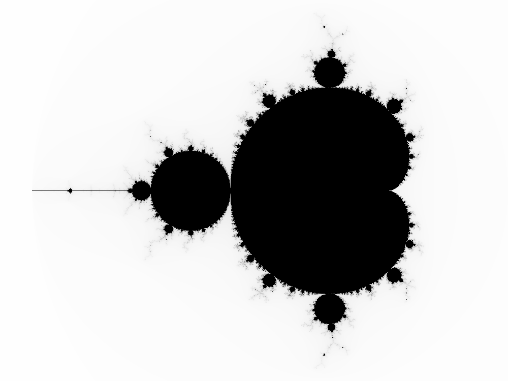

# Mandelbrot



A Mandelbrot set renderer written in Rust. It computes the set over a region of the complex plane and saves the result as a greyscale PNG.

## Overview

The program maps each pixel to a complex number `c` and iterates `z = z^2 + c` starting from `z = 0`. If `|z|` exceeds 2, the point is guaranteed to diverge and escape outside the set. Points that do not escape within a fixed number of iterations are treated as members of the mandelbrot set.

- Points in the set are drawn black.
- Points outside the set are shaded by how quickly they escape, with faster escapes drawn brighter.

## Requirements

- Rust (stable), installed via [rustup](https://rustup.rs)

## Usage

```
cargo run --release
```

This writes `mandelbrot.png` to the project root. Building in release mode is recommended, as it is significantly faster.

## Testing

```
cargo test
```

## Project structure

```
src/
  main.rs    Complex number type, escape-time algorithm, pixel mapping and rendering
  tests.rs   Unit tests
```

## Configuration

The image size and the region of the complex plane are set in `main`:

- `bounds`: output image dimensions in pixels (width, height)
- `upper_left`, `lower_right`: the corners of the region to render

## Dependencies

- [image](https://crates.io/crates/image): PNG encoding
